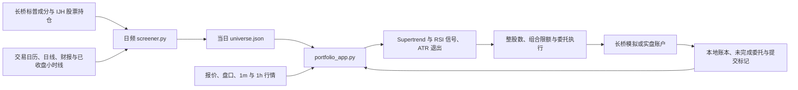

# Supertrend + RSI 策略设计

策略分两次做决定。盘前先选出流动性充足、相对 SPY 较强且上涨趋势仍在延续的美股。盘中等待其中一只股票在小时级上涨趋势内重新取得动量，再根据实时盘口、可用现金和组合风险决定能买多少。候选上限为 100 只，同时持仓上限为 5 只，一个交易日可以零成交。

## 数据怎样流到账户

选股进程使用 HTTP，一次运行即可发布。账户进程在同一个行情上下文中订阅多个标的和周期，交易使用独立的交易上下文。账户每轮合并**按排名排列的候选、已有持仓、有效委托和未决提交**。持仓掉出候选后仍有退出管理，股票池失效只会撤去开仓资格。账户模式、资金、资格日期、规则、候选顺序或需管理的敞口变化时重新组装策略。只刷新淘汰明细等诊断字段时可复用实例，每轮仍重新同步风险与订单。[选股入口](screener.py) · [组合入口](portfolio_app.py)

## 盘前选股

1. 使用美东交易日历确定目标日和前一完整交易日。方案 C 将长桥当日返回的全量标普 500 成分与 iShares IJH 最近披露的股票持仓合并去重。IJH 作为美国中盘股代理，筛去现金和衍生品。成分缓存按目标日保存来源数量、持仓日期与文件摘要。两组成分共同排名，名额依评分决定。[成分处理](supertrend_universe.py)
2. 默认请求 300 根日线，有效历史至少 250 根，最近 61 根日期须与 SPY 对齐。前复权价格用于趋势和相对收益，流动性使用未复权成交额。要求收盘价至少 10 美元，近 20 日平均成交额至少 5,000 万美元，收盘在 EMA50 之上且 EMA50 高于 10 个交易日前。近 20、60 日收益均须跑赢 SPY。收盘高于 EMA20 的距离最多为 4 倍日 ATR(14)。剔除在目标日及随后两个交易日有财报的股票。[筛选与排序](../../../../investing_algorithm_framework/infrastructure/longbridge/selection.py)
3. `RS20` 与 `RS60` 分别表示股票与 SPY 在相应窗口的收益率之差。排序分为 `(RS20 + RS60) / (2 × max(60 日年化波动率, 0.10))`，波动率按收盘日收益样本标准差乘 `√252` 计算。得分相同先取 RS60 较高者，再按股票代码升序。这个分数用于排队，不能解释为预期回报。
4. 按分数从高到低检查候选。与任一已入选股票的 60 日收益率正相关系数大于 `0.85` 时跳过该股。再用已收盘小时线计算 ATR(10)，若按名义预算、现金和单笔风险连一股都买不起，继续考察下一名。只对最终入选者占用名额，符合条件较少时可以少于 100 只。[正式规则与快照](screener.py)

`universe.json` 记录交易日、数据截止日、基础池、规则、按名次排列的 `selected`、逐只 `rejected` 与 `errors`。单股数据异常有记录并跳过。公共输入失效、整组成分日线读取失败等情况会保留旧文件并写入 `universe.error.json`。账户有失败标记时暂停开仓，成功发布后选股进程清除标记。财报查询按最多 10 只分批，连接错误、超时或限流只重试当前批次，最多三次。

## 小时信号和分钟风控

上游 Pine 默认只做多。此移植保留其严格比较、Supertrend 方向符号和开平条件，指标共用同一份 Wilder 平滑。ATR 和 RSI 以最初一段有效样本的算术均值启动，后续按 `上一值 + (当前值 − 上一值) / 周期` 更新。预热历史会影响递归初值。[上游固定版本](https://github.com/Alorse/pinescript-strategies/blob/8fb3837ddcd137f1450c3e82d654ff3df24d54d5/strategies/trend/Supertrend%20%2B%20RSI.pine) · [信号实现](supertrend_rsi.py)

| 决策 | 实际触发条件 |
| --- | --- |
| 趋势 | 基础轨道为 `(High + Low) / 2 ± 3 × ATR(10)`。最终轨道根据上一根轨道和收盘价延续，收盘突破相应轨道时翻转。方向 `−1` 表示上涨，`+1` 表示下跌。 |
| 开多 | 已确认小时线上 `方向 < 0`，上一根 `RSI(14) < 50`，本根 `RSI(14) > 50`。恰好等于 50 不满足穿越。 |
| 普通退出 | `RSI(14) > 72`，或方向由上涨翻为下跌。持仓时优先处理退出。 |
| 账户 ATR 退出 | 记录入场信号时 `2 × 小时 ATR(10)` 的固定距离。每分钟按实际买入成交价减该距离检查买一价，触发后锁定该标的的退出意图。 |

1m 行情提供风控心跳，普通信号只读取最新、已完成且符合交易日历的主周期 K 线。常规日最后一根小时线为美东 15:30–16:00，提前收市日为 12:30–13:00。确认推送迟到时有宽限期和限速历史补拉，再次读取仍不匹配则记录 `stale_or_unconfirmed_bar`。风险退出及已经锁定的退出意图可以在小时线未更新时继续处理。[推送与补拉](../../../../investing_algorithm_framework/infrastructure/longbridge/__init__.py) · [运行控制](../../../../investing_algorithm_framework/infrastructure/longbridge/runtime.py)

## 仓位与执行

| 组合参数 | 默认值 | 用途 |
| --- | ---: | --- |
| 管理资金 | 25,000 USD | 选股估算的基数和账户初始配置 |
| 单笔名义上限 | 4,500 USD | 限制一只股票占用的资金 |
| 单笔计划风险 | 净值的 0.5% | 风险金额除以固定退出距离 |
| 总计划风险 | 净值的 2.5% | 已有持仓和未成交买单都占用额度 |
| 最多同时持有 | 5 只 | 已持有或有有效买单的股票占用名额 |

买入执行时，用卖一价重新计算可买整股数。最终数量取框架拟下单量、名义预算、可用现金的 98%、单笔风险和组合剩余风险各自允许的最小值，向下取整。结果达到一股即可提交。举例来说，净值 25,000 美元、卖一价 150 美元、止损距离 5 美元时，名义预算允许 30 股，单笔风险允许 25 股。若组合只剩 50 美元风险空间，最多买 10 股。现金、盘口和名额还会进一步限制结果。[默认资金参数](settings.py) · [整股执行](../../../../investing_algorithm_framework/infrastructure/longbridge/execution.py) · [组合风险](../../../../investing_algorithm_framework/infrastructure/longbridge/portfolio.py)

开仓窗口从美东 09:35 到收市前五分钟，不含右端点。要求报价处于正常交易状态、在 120 秒内，且双边价差不超过中间价的 0.15%。普通买卖以卖一或买一提交限价单。ATR 紧急退出走市价卖出，退出可在整个常规时段处理。挂单超时先撤单、等待确认并按剩余持仓处理。退出管理依赖进程、有效报价和市场可成交性，跳空与滑点可以令实际损失超过预算。

每根主周期信号的时间水位在发出普通意图前写入本地。因盘口、名额或预算被拒的买入会等待下一次信号。退出意图则持久化到持仓归零。提交结果不明时保留本地标记，账户预检会提示与券商委托对账。正式模式与模拟模式分别绑定账本和相应授权，两者的交易模式都会向对应的券商账户提交委托。

## 验证的含义

420 根合成 K 线与独立 PineTS 参考逐行核对 ATR、RSI、Supertrend 方向和开平信号。框架事件测试通过模拟券商传输覆盖下单、成交、部分成交、重启、失效快照、尾根确认和退出。CSV 向量回测只运行上游默认的多头规则和 20% 仓位。组合账户另有每日选股、五仓竞争、盘口执行和分钟 ATR 退出，评估收益需要逐日冻结的成分和财报、交易费用、滑点及成交时序。[参考数据](../../../../tests/resources/supertrend_rsi_pine.csv) · [信号测试](../../../../tests/examples/test_supertrend_rsi.py) · [账户测试](../../../../tests/examples/test_supertrend_runtime.py)

预期在相对强势股票的上涨趋势恢复时取得机会。震荡市场容易反复穿越 RSI 中线，陡峭上涨也可能被 RSI 退出提前截断。策略没有固定持仓期限，五个名额会让同一小时出现的买点相互竞争。已有的相关性和扩池实验覆盖有限交易日，使用了当时的候选上限及部分事后补采输入。正式 C 池 100 候选的长期净收益、回撤和持仓周期分布仍需独立样本验证。[选股范围与仓位竞争](universe_slots.zh-CN.md) · [相关性实验](correlation_experiment.zh-CN.md)
